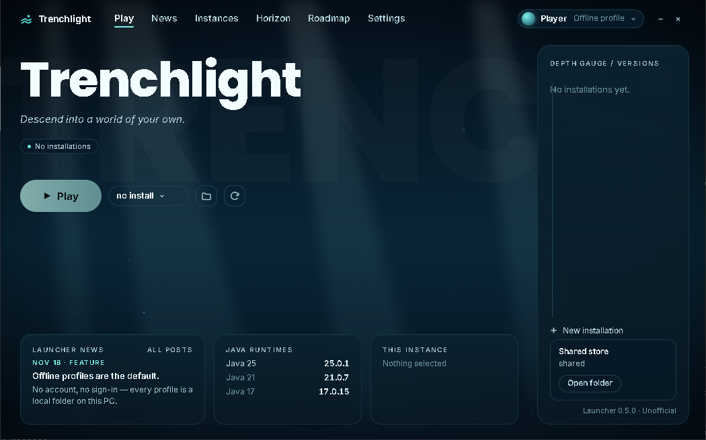
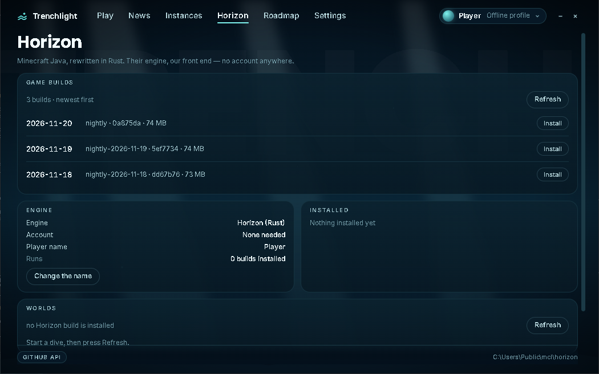
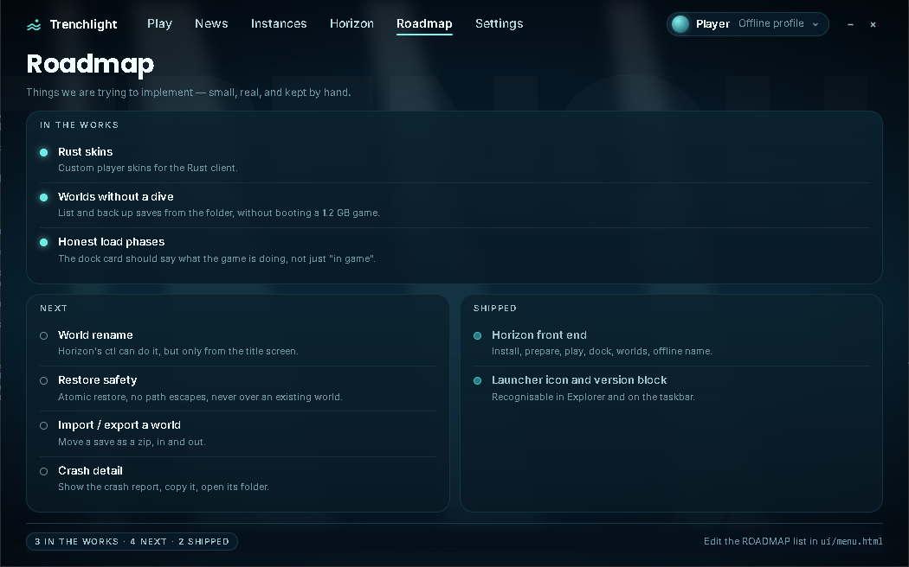

# Trenchlight

**A Minecraft: Java Edition launcher for Windows, written in Rust.** Isolated
instances over one shared data store, offline accounts, and a page that runs
**Horizon** — a Rust/wgpu client that needs no Microsoft account.

[](https://github.com/LaziestBe/TrenchLight/actions/workflows/ci.yml)
[](LICENSE)
[](#requirements)
[](https://www.rust-lang.org)



Three binaries come out of the same workspace:

| Binary | What it is |
| --- | --- |
| `trenchlight.exe` | The GUI (wry + WebView2). Double-click it. |
| `mcl.exe` | The CLI. Double-clicking it with no arguments opens the GUI; `mcl --help` lists the commands. |
| `mcl-world.exe` | An experimental native world viewer (wgpu). Stage 0: a window. Not a product yet. |

## Status

Working and verified against **26.3** (Java 25, modern argument format),
**Forge 26.1.2** and **1.12.2** (Java 8, legacy arguments), plus the Horizon
page end to end. It is a personal launcher, not a polished product: there is no
auto-updater, no telemetry, and no installer.

## Requirements

- Windows 10 or 11, x64.
- The **WebView2 runtime** for the GUI. Windows 11 and current Windows 10 ship
  it; if the window never appears, install the Evergreen runtime from Microsoft.
- Java for the game itself. The launcher detects installed runtimes and lets
  each instance pin one; it does not download Java.
- Rust (stable, MSVC toolchain) only if you build from source.

## Build

```powershell
cargo build --release --workspace
```

The binaries land in `target\release\`.

Two rules matter:

- **Always build the workspace** (`--workspace`). `world\` is a separate member,
  and a bare `cargo build` at the root does not build it.
- **Close `trenchlight.exe` before rebuilding.** Windows keeps the running exe
  locked and the linker fails with `access denied (os error 5)`.

The icon and version block are compiled in by `build.rs`, which calls `rc.exe`
from the Windows SDK. If the SDK is missing, the build fails there instead of
shipping a blank icon.

## Run

Double-click `trenchlight.exe`, or from a terminal:

```powershell
target\release\trenchlight.exe
```

State lives in `%APPDATA%\mcl`:

```
settings.json
shared\                      one Minecraft data store (assets, libraries, versions)
instances\<name>\            per-instance game folder, overrides, skin
horizon\
  builds\<build>\             Horizon releases, downloaded and hash-checked
  resources\<build>\          prepared Horizon assets
  instances\horizon\          the one shared Horizon game folder: saves, backups
```

## Offline accounts

The launcher never contacts Mojang's authentication servers. The game is told
it has a `legacy` session with a zero token and a name-derived UUID — the same
thing Prism/MultiMC do for an "offline" account.

That means singleplayer works, and servers with `online-mode=false` work.
Online-mode servers, Realms and Mojang-hosted services do not; the client logs a
harmless `401` for player attributes and a Realms warning on every launch. That
is expected, not a bug.

## The Horizon page

Horizon is a separate, LGPL-3.0 Minecraft client written in Rust. The Horizon
page installs a release, prepares its resources, launches it, and manages its
worlds — **without Horizon's own launcher and without an account**.

How it stays honest:

- Builds are downloaded from Horizon's official GitHub releases and checked
  against the published SHA-256 before anything is unpacked. A corrupted
  download is refused, and there is a test that proves it.
- Launching goes through `horizon-ctl.exe` and `horizon-prepare.exe` with
  explicit paths. `horizon-launcher.exe` is never started.
- No Horizon source is copied, compiled, patched or redistributed here.
- The pinned server jar is fetched from Mojang's content store and checked by
  SHA-1.

Worlds can be listed, backed up, restored, screenshotted and deleted. All
Horizon builds share one game folder on purpose, so a new nightly never hides
yesterday's world.



`horizon-ctl` has quirks the page papers over: `worlds` only answers while a
game is running, `world-backup` needs the title screen, `world-delete` refuses
without `--confirm`, and ctl splits its command line on spaces, so world folders
containing spaces are zipped and deleted by the launcher itself. More detail in
[`docs/HORIZON.md`](docs/HORIZON.md).

## The world viewer (experimental)

`mcl-world.exe` is a separate binary because wgpu must never link into the
launcher: a GPU driver fault would take the GUI down with it. It currently opens
a window and draws a triangle on Vulkan and Dx12. It does not read worlds yet.
Do not treat it as a feature.

## Roadmap

The app has a Roadmap page, kept by hand in `ui/menu.html` — small things that
are being worked on, what comes next, and what has shipped.



## CLI

```
mcl versions            list installable versions
mcl install <version>   download client, libraries and assets
mcl installed           list versions in the data store
mcl create <name> --version <v> [--user <name>]
mcl list                list instances
mcl info <name>         show an instance and its exact java command
mcl play <name>         launch it
mcl delete <name>       delete the instance, keep the shared store
mcl java                show detected Java installations
mcl config              show or change settings
mcl import <dir>        turn a version folder into an instance
```

`--root` moves the state directory; `--shared` points at an existing
`.minecraft` folder to reuse assets and libraries.

## Tests

```powershell
cargo test --workspace
```

65 unit tests in the launcher and 38 in the world viewer, including the
negative controls for the Horizon installer (a one-byte-corrupted archive must
be refused) and for world restore.

## Licence

MIT for this code — see [LICENSE](LICENSE). Horizon, Minecraft and the WebView2
runtime are not part of this repository and are not redistributed; see
[NOTICE.md](NOTICE.md). Not affiliated with Mojang, Microsoft or the Horizon
project.
